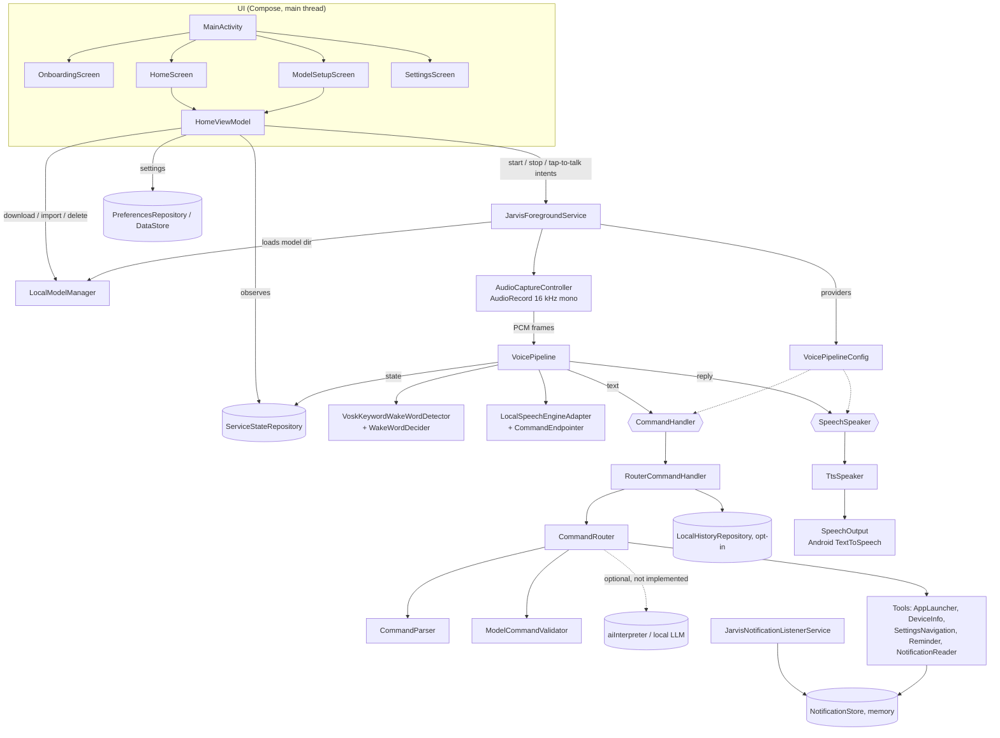
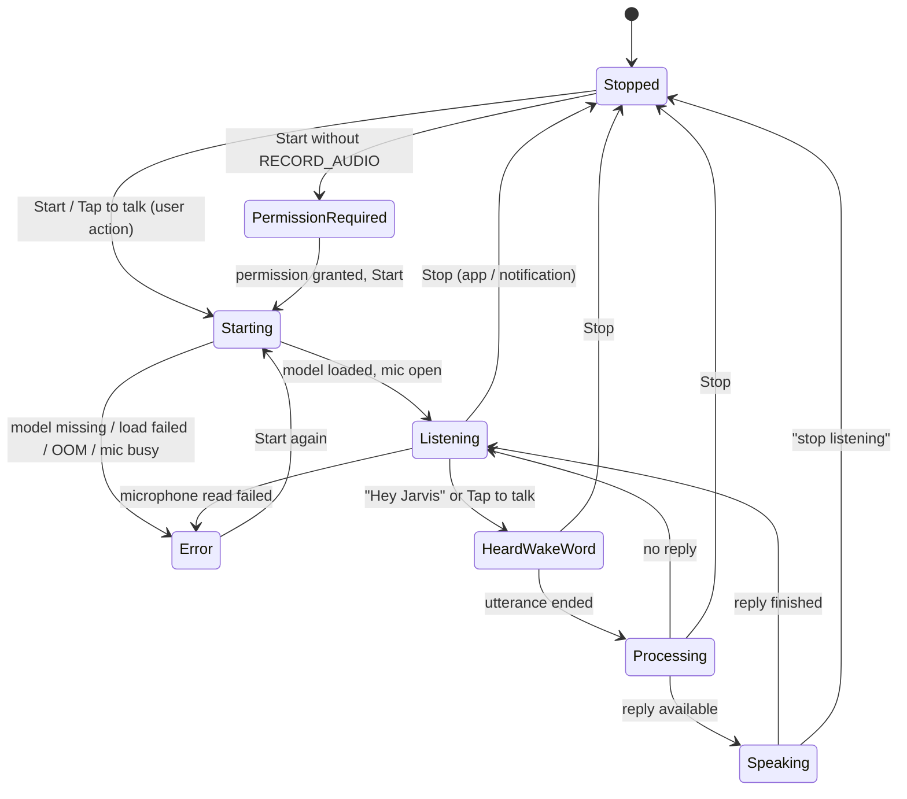

# JARVIS architecture

This describes the code as it exists in `app/src/main/java/com/jarvis/assistant/`.
Nothing here has been verified on a real device or emulator yet (see [TEST_PLAN.md](TEST_PLAN.md)).

## 1. Components



`VoicePipelineConfig` providers create, per listening session, a `RouterCommandHandler`
(builds `CommandRouter` with the Android tools and records opt-in history) and a
`TtsSpeaker` (wraps `SpeechOutput`). Both are closed when listening stops. Tests can swap
the providers (e.g. `EchoCommandHandler`, `SpeechSpeaker.NoOp`). The local LLM is
**not implemented**; `aiInterpreter` is `null`.

## 2. Voice pipeline

```text
Microphone (AudioRecord, VOICE_RECOGNITION source, 16 kHz, PCM16, 512-sample frames ≈ 32 ms)
  -> AudioCaptureController (sole mic owner, IO dispatcher)
  -> VoicePipeline.offerFrame()  (copies frame into a 32-frame DROP_OLDEST channel)
  -> mode WakeWord: VoskKeywordWakeWordDetector (grammar ["hey jarvis","jarvis","[unk]"])
       └ WakeWordDecider: sensitivity→required confidence (0→0.95 … 1→0.35), 2 s cooldown
  -> mode Command: LocalSpeechEngineAdapter (unrestricted Vosk recognizer)
       └ CommandEndpointer: no speech 4 s / trailing silence 1.2 s / max 6 s
  -> SpeechResult (text + average word confidence)
       ├ empty + NoSpeech      -> "I didn't hear a command."
       ├ empty or conf < 0.4   -> "Sorry, I didn't catch that."
       └ else CommandHandler.handle()   (10 s timeout)
            └ CommandRouter: CommandParser → [optional AI → ModelCommandValidator] → tool
  -> SpeechSpeaker.speak(reply)  (30 s timeout; mic frames discarded meanwhile)
  -> drain queued frames, resume wake word  (or stop the service on "stop listening")
```

Tap-to-talk (home-screen button or the notification **Talk** action) skips the wake-word stage.

### Command routing rules (`CommandRouter`)
1. Parse deterministically. **Stop** always wins (and clears any pending question).
2. **Repeat** returns the last reply.
3. If the previous reply was a yes/no question (`NeedsConfirmation`) or an app choice
   (`Ambiguous`), the utterance is treated as the answer.
4. Unknown text may go to the optional `aiInterpreter` (8 s timeout); its JSON output must
   pass `ModelCommandValidator`'s allow-list, and it can never produce Stop/Repeat.
5. Execute the typed `JarvisCommand` with a tool. Replies claim success only when the
   Android call succeeded (e.g. `startActivity` did not throw).

Typed commands: `OpenApp`, `GetBattery`, `GetTime`, `OpenSettings(destination)`,
`StopListening`, `Repeat`, `ReadLatestNotification`,
`CreateReminder(title, delayMinutes 1..1440)`, `Unknown`.

## 3. Threading

| Work | Thread / dispatcher |
|---|---|
| Compose UI, service lifecycle, notification, teardown | Main |
| Vosk model load (`Model(path)`) | `Dispatchers.IO` + `NonCancellable` (closed if Stop arrives meanwhile) |
| `AudioRecord.read` loop | `Dispatchers.IO` coroutine in `AudioCaptureController` |
| Wake word, STT, command handling, waiting for TTS | one consumer coroutine on `Dispatchers.Default` in `VoicePipeline` — the only code touching the native recognizers |
| Querying launchable apps | `Dispatchers.IO` |
| Model download / verify / unzip | `Dispatchers.IO` in `LocalModelManager` |
| TTS engine callbacks | posted to Main; `speak()` suspends on a `CompletableDeferred` |
| Settings / history | DataStore; history file on `Dispatchers.IO` under a `Mutex` |

Native resources are released only after the consumer coroutine completes
(`invokeOnCompletion`): recognizers first, then the shared Vosk `Model`, then any
`AutoCloseable` handler/speaker. `AudioRecord` is released only after its read loop exits.

## 4. State machine (`ServiceState`)



`ServiceStateRepository.updateIfActive()` uses compare-and-set so a late callback
cannot move a stopped service back into an active state. Active states:
Starting, Listening, HeardWakeWord, Processing, Speaking.

## 5. Package map

| Package | Key files | Responsibility |
|---|---|---|
| `com.jarvis.assistant` | `MainActivity.kt` | Single activity; chooses onboarding / home / model setup |
| `onboarding` | `OnboardingScreen.kt` | First-run explanation; requests nothing |
| `ui` | `HomeScreen.kt`, `HomeViewModel.kt`, `ModelSetupScreen.kt`, `SettingsScreen.kt` | Start/Stop, Tap to talk, status, sensitivity slider; model download/import/delete; `SettingsScreen.kt` (history opt-in/clear, notification access, TTS settings, MIUI tips, permissions — newly added by the integration work). |
| `permissions` | `PermissionManager.kt` | Runtime permission checks; mic + (Android 13+) notifications |
| `service` | `JarvisForegroundService.kt`, `AudioCaptureController.kt`, `VoicePipeline.kt`, `VoicePipelineConfig.kt`, `RouterCommandHandler.kt`, `ServiceState.kt` | Foreground microphone service, capture, pipeline, state, router/TTS providers |
| `wakeword` | `WakeWordDetector.kt`, `VoskKeywordWakeWordDetector.kt`, `WakeWordDecider.kt` | Provider-neutral interface, Vosk keyword spotter, pure decision logic |
| `speech` | `SpeechToTextEngine.kt`, `LocalSpeechEngineAdapter.kt`, `CommandEndpointer.kt`, `VoskJson.kt`, `ModelArchive.kt` | STT interface + Vosk adapter, utterance bounding, Vosk JSON parsing, safe zip/hash |
| `ai` | `LocalModelManager.kt` | Speech-model spec and download/import/verify/install/delete (no LLM yet) |
| `commands` | `Command.kt`, `CommandParser.kt`, `CommandRouter.kt`, `ModelCommandValidator.kt` | Typed commands, deterministic parser, router, allow-list JSON validator |
| `tools` | `Tools.kt`, `AndroidAppLauncher.kt`, `AppNameResolver.kt`, `AndroidDeviceInfoTool.kt`, `AndroidSettingsNavigationTool.kt`, `AndroidReminderTool.kt`, `JarvisNotificationListenerService.kt` | Tool interfaces and Android implementations |
| `tts` | `SpeechOutput.kt`, `TtsSpeaker.kt` | Android `TextToSpeech` wrapper, language fallback, TTS settings shortcut |
| `data` | `PreferencesRepository.kt`, `LocalHistoryRepository.kt` | DataStore settings (onboarding, history opt-in, sensitivity); opt-in history file |

## 6. Design decisions

- **One microphone owner.** Vosk's own `SpeechService` (which opens its own `AudioRecord`)
  is not used; `AudioCaptureController` feeds both recognizers.
- **One Vosk model** (small English) serves both the wake-word grammar recognizer and the
  command recognizer, so only one model is loaded. Memory use has not been measured.
- **Self-echo protection.** While processing/speaking, frames are dropped and the queue is
  drained before the wake word resumes.
- **Deterministic first.** The parser handles every supported command without any model;
  the LLM hook is optional and its output is validated.
- **No shell, no arbitrary intents.** Tools call fixed Android APIs and official
  `Settings` intents; settings are opened, never toggled.
