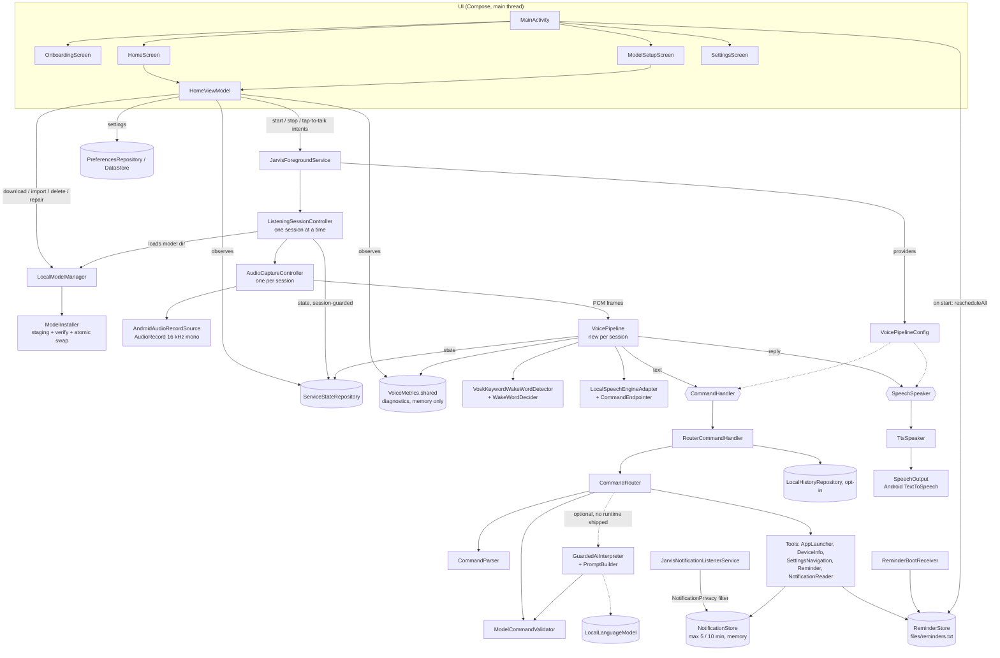
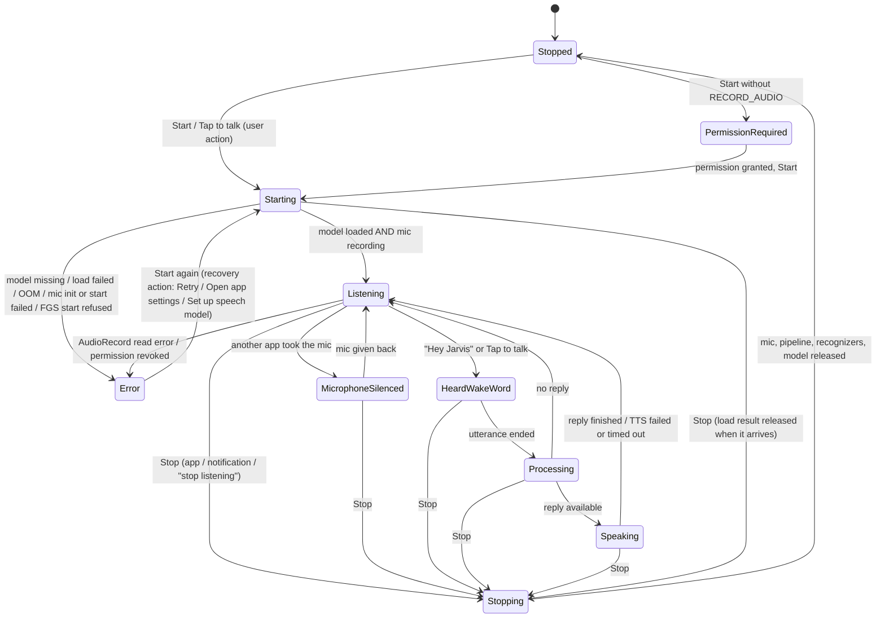

# JARVIS architecture

This describes the code in `app/src/main/java/com/jarvis/assistant/` as of 2026-10-27.
The lifecycle was checked with JVM unit tests (fakes), with the instrumentation suite on an
API 31 emulator, and with 5 Start/Stop cycles on a Redmi Note 10S (Android 13, debug
build). Wake-word and recognition quality have not been measured
(see [TEST_PLAN.md](TEST_PLAN.md)).

## 1. Components



`VoicePipelineConfig` providers create, per listening session, a `RouterCommandHandler`
(builds `CommandRouter` with the Android tools and records opt-in history) and a
`TtsSpeaker` (wraps `SpeechOutput`). Both are closed when listening stops. Tests can swap
the providers (e.g. `EchoCommandHandler`, `SpeechSpeaker.NoOp`). No local LLM runtime
ships; `aiInterpreter` is `null`. `GuardedAiInterpreter` is the only allowed way to plug one
in later.

## 1a. Listening session controller

`JarvisForegroundService` holds no lifecycle logic itself. It delegates to
`ListeningSessionController`, which uses no Android framework types, so the JVM tests can
drive it with fakes:

- **Session tokens.** Each Start creates a `Session` with an increasing generation. Every
  state write from a pipeline or capture callback goes through `setStateFor(session, …)`.
  The write is rejected once that session is no longer current or is stopping, so a late
  callback cannot bring back a stopped service or leak into a newer session.
- **Idempotent Start.** A Start while a session exists returns `AlreadyRunning`. It only
  forwards a tap-to-talk request and never creates a second microphone owner.
- **New instances per session.** Each session gets a new `VoicePipeline` and
  `AudioCaptureController`. Cancelled instances are never reused.
- **Observable shutdown.** Stop moves the state to `Stopping` (or `Error`) at once.
  `Stopped` is set only after capture, pipeline, recognizers, model and handler/speaker are
  released. `stopAndJoin()` suspends until that point. A new session waits for the previous
  teardown before it opens the microphone, including teardown left over from a destroyed
  service instance (`priorTeardown`).
- **Listening only after the mic is open.** `Starting` becomes `Listening` only after
  `AudioRecord.startRecording()` succeeded.
- **Capture errors.** AudioRecord init/start failures and negative read codes
  (`ERROR_INVALID_OPERATION`, `ERROR_BAD_VALUE`, `ERROR_DEAD_OBJECT`, `ERROR`) end the session
  with `Error(message, recovery)`. `recovery` is `Retry`, `OpenAppSettings` or
  `OpenModelSetup`, and the home screen shows the matching button.
- **Microphone silenced.** On API 29+ an `AudioRecordingCallback` reports when Android
  silences JARVIS because another app took the mic. The state becomes `MicrophoneSilenced`
  and returns to `Listening` when the mic is given back.
- **Service-level rules.** `START_NOT_STICKY`. Exceptions from `startForeground`
  (including `ForegroundServiceStartNotAllowedException`) are caught and reported. The
  notification **Talk** action is honoured only while `Listening`. `onTaskRemoved` keeps
  the default behaviour, so listening continues with the notification visible. Nothing
  starts listening at boot.

### Resource ownership

| Resource | Owner | Released |
|---|---|---|
| Session lifecycle / generation | `ListeningSessionController` | `stop()` / `stopAndJoin()`; `Stopped` only after full release |
| `AudioRecord` + read coroutine | `AudioCaptureController` (one per session) | after the read loop exits (`stopAndJoin`) |
| `VoicePipeline` + its consumer coroutine | the session (new instance per session) | `VoicePipeline.stopAndJoin()` |
| Vosk wake + command `Recognizer`s | the pipeline's consumer coroutine | its completion handler, after the last use |
| Shared Vosk `Model` | the session's `LoadResult.Ready` | `onClose`, after the recognizers were freed |
| TTS speaker, command handler | the session (fresh from `VoicePipelineConfig`) | `onClose` (if `AutoCloseable`) |
| Foreground notification | `JarvisForegroundService` | `onIdle` → `stopForeground` + `stopSelf`, or `onDestroy` |
| Installed model files | `ModelInstaller` (via `LocalModelManager`) | delete is refused while the service state is active |

## 2. Voice pipeline

```text
Microphone (AudioRecord, VOICE_RECOGNITION source, 16 kHz, PCM16, 512-sample frames ≈ 32 ms)
  -> AudioCaptureController (sole mic owner, IO dispatcher)
  -> VoicePipeline.offerFrame()  (copies frame into a 32-frame DROP_OLDEST channel)
  -> mode WakeWord: VoskKeywordWakeWordDetector (grammar ["hey jarvis","jarvis","[unk]"])
       └ WakeWordDecider: sensitivity gates (see LOCAL_MODELS.md), 2 s cooldown,
         cooldown restarted when a command session ends; one utterance -> one session
  -> mode Command: LocalSpeechEngineAdapter (unrestricted Vosk recognizer)
       └ CommandEndpointer: no speech 4 s / trailing silence 1.2 s / max 6 s
  -> SpeechResult (text + average word confidence)
       ├ WakePhrase.stripLeading(text)     ("hey jarvis open youtube" -> "open youtube")
       ├ empty + NoSpeech                  -> "I didn't hear a command…"
       ├ only the wake phrase              -> "Yes? Say "Hey Jarvis" followed by a command."
       ├ conf < 0.4                        -> "Sorry, I didn't catch that clearly…" (handler never called)
       └ else CommandHandler.handle()      (10 s timeout -> error reply)
            └ CommandRouter: CommandParser → [optional GuardedAiInterpreter → ModelCommandValidator] → tool
  -> SpeechSpeaker.speak(reply)  (30 s timeout; failure/timeout -> back to Listening; mic frames discarded meanwhile)
  -> drain queued frames, resume wake word  (or end the session on "stop listening")
```

A recognizer `finish()` failure, a handler exception or timeout, and a TTS failure or hang
all lead back to `Listening`. None of them can leave the pipeline stuck. If a state write
is rejected (the session is no longer current), the pipeline stops instead of continuing.
Counts and latencies go to `VoiceMetrics` (no text).

Tap-to-talk (home-screen button or the notification **Talk** action) skips the wake-word stage.

### Command routing rules (`CommandRouter`)
1. Parse deterministically. Vosk mis-hearings are fixed first, number words are parsed,
   and wake prefixes/fillers are stripped. **Stop** always wins, even at low confidence,
   and clears any pending question.
2. **Repeat** returns the last reply only. It never runs a previous action again and keeps
   a pending question.
3. If the previous reply was a yes/no question (`NeedsConfirmation`) or an app choice
   (`Ambiguous`, at most 3 options), the utterance is treated as the answer. Only fixed yes/no
   phrase sets count. A low-confidence "yes" does not confirm. An unrelated answer gets one
   re-prompt, then the request is cancelled. Pending questions expire after 30 s.
4. A `CreateReminder` heard with low confidence (< 0.5) is not executed directly; JARVIS
   asks for confirmation first. `InvalidReminder(reason)` is explained and never scheduled.
5. Unknown text (confidence ≥ 0.5) may go to the optional AI interpreter (8 s timeout). Its
   JSON must pass `ModelCommandValidator`. It can never produce Stop/Repeat, and model-proposed
   consequential commands always need confirmation.
6. Execute the typed `JarvisCommand` with a tool. Replies claim success only when the
   Android call succeeded (e.g. `startActivity` did not throw). A reminder failure speaks
   the reason (e.g. notifications turned off).

Typed commands: `OpenApp`, `GetBattery`, `GetChargingStatus`, `GetTime`, `GetDate`,
`OpenSettings(destination)`, `UnsupportedToggle(destination)` (offers the settings page,
never toggles), `StopListening`, `Repeat`, `ReadLatestNotification`,
`CreateReminder(title ≤ 100 chars, delayMinutes 1..1440)`, `InvalidReminder(reason)`, `Unknown`.

## 3. Threading

| Work | Thread / dispatcher |
|---|---|
| Compose UI, service lifecycle, notification | Main |
| Session model load and teardown | `ListeningSessionController`'s never-cancelled background scope on `Dispatchers.IO`. Loads always finish; the controller releases the result if Stop arrived meanwhile. |
| `AudioRecord.read` loop | `Dispatchers.IO` coroutine in `AudioCaptureController` |
| Wake word, STT, command handling, waiting for TTS | one consumer coroutine on `Dispatchers.Default` in `VoicePipeline` — the only code touching the native recognizers |
| Querying launchable apps | `Dispatchers.IO` |
| Model download / verify / unzip / test load / swap | `Dispatchers.IO` in `LocalModelManager` → `ModelInstaller` |
| Reminder rescheduling at boot | `ReminderBootReceiver` worker thread (`goAsync`) |
| TTS engine callbacks | posted to Main; `speak()` suspends on a `CompletableDeferred` |
| Settings / history | DataStore; history file on `Dispatchers.IO` under a `Mutex` |

Teardown order: the session's start job is cancelled and joined, the pending load is
awaited, then capture `stopAndJoin` (AudioRecord released after the read loop exits), then
pipeline `stopAndJoin` (recognizers freed by the consumer's completion handler), then
`onClose` (shared Vosk `Model`, `AutoCloseable` handler/speaker).

## 4. State machine (`ServiceState`)



Active states (`isActive`, the mic pipeline is owned): Starting, Listening,
MicrophoneSilenced, HeardWakeWord, Processing, Speaking. `Stopping`, `Stopped`,
`PermissionRequired` and `Error` are inactive, and the UI never shows them as listening.
All writes go through the controller's session check (§1a), and
`ServiceStateRepository.updateIfActive()` uses compare-and-set. If anything else moves
the shared state to an inactive value, the controller ends the session, so the
microphone is never left open behind a UI that says it is not listening.
## 5. Package map

| Package | Key files | Responsibility |
|---|---|---|
| `com.jarvis.assistant` | `MainActivity.kt` | Single activity; chooses onboarding / home / model setup; reschedules saved reminders on start |
| `onboarding` | `OnboardingScreen.kt` | First-run explanation; requests nothing |
| `ui` | `HomeScreen.kt`, `HomeViewModel.kt`, `ModelSetupScreen.kt`, `SettingsScreen.kt` | Start/Stop, Tap to talk, status + error recovery buttons, sensitivity slider, diagnostics panel; model download/import/delete/repair; settings (history opt-in with confirmation, clear, notification access + exclusions, TTS settings, reminders info, MIUI tips, permissions) |
| `permissions` | `PermissionManager.kt` | Runtime permission checks; mic + (Android 13+) notifications |
| `service` | `JarvisForegroundService.kt`, `ListeningSessionController.kt`, `AudioCaptureController.kt`, `AudioSource.kt`, `VoicePipeline.kt`, `VoicePipelineConfig.kt`, `RouterCommandHandler.kt`, `ServiceState.kt`, `VoiceMetrics.kt` | Foreground microphone service, session lifecycle, capture + AudioRecord abstraction, pipeline, state, router/TTS providers, diagnostics counters |
| `wakeword` | `WakeWordDetector.kt`, `VoskKeywordWakeWordDetector.kt`, `WakeWordDecider.kt`, `WakePhrase.kt` | Provider-neutral interface, Vosk keyword spotter, pure decision logic, wake-phrase stripping |
| `speech` | `SpeechToTextEngine.kt`, `LocalSpeechEngineAdapter.kt`, `CommandEndpointer.kt`, `VoskJson.kt`, `ModelArchive.kt` | STT interface + Vosk adapter, utterance bounding, Vosk JSON parsing, safe zip/hash |
| `ai` | `LocalModelManager.kt`, `ModelInstaller.kt` | Android-side download/import/delete; pure-JVM `ModelCatalog`, `ModelDownloadPolicy`, `ModelInstaller` (no LLM runtime) |
| `commands` | `Command.kt`, `CommandParser.kt`, `CommandRouter.kt`, `ModelCommandValidator.kt`, `GuardedAiInterpreter.kt`, `Clock.kt` | Typed commands, deterministic parser, router, strict JSON validator, LLM guard + prompt builder, injectable clock |
| `tools` | `Tools.kt`, `AndroidAppLauncher.kt`, `AppNameResolver.kt`, `AndroidDeviceInfoTool.kt`, `AndroidSettingsNavigationTool.kt`, `AndroidReminderTool.kt` (+ `ReminderReceiver`, `ReminderBootReceiver`), `ReminderStore.kt`, `JarvisNotificationListenerService.kt`, `NotificationPrivacy.kt`, `ActivityStarter.kt` | Tool interfaces and Android implementations, reminder persistence/validation, notification privacy filter and in-memory store |
| `tts` | `SpeechOutput.kt`, `TtsSpeaker.kt` | Android `TextToSpeech` wrapper, language fallback, TTS settings shortcut |
| `data` | `PreferencesRepository.kt`, `LocalHistoryRepository.kt` | DataStore settings (onboarding, history opt-in, sensitivity, notification privacy); opt-in history file with `HistorySanitizer` |

## 6. Design decisions

- **One microphone owner.** Vosk's own `SpeechService` (which opens its own `AudioRecord`)
  is not used; `AudioCaptureController` feeds both recognizers, and only one session can exist.
- **One Vosk model** (small English) serves both the wake-word grammar recognizer and the
  command recognizer, so only one model is loaded. Memory use has not been measured.
- **Self-echo protection.** While processing/speaking, frames are dropped and the queue is
  drained before the wake word resumes.
- **Deterministic first.** The parser handles every supported command without any model;
  the LLM hook is optional and its output is validated.
- **No shell, no arbitrary intents.** Tools call fixed Android APIs and official
  `Settings` intents; settings are opened, never toggled.
